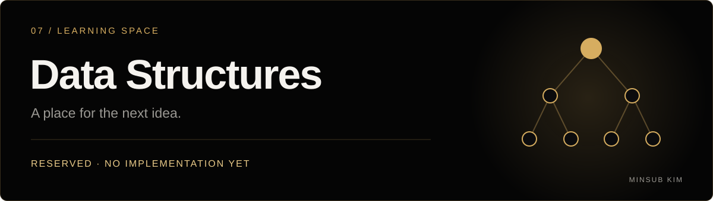

<!-- MINSUB-BRAND:START -->

  

  

  <a href="https://github.com/minsub1489">개발자 프로필</a> · <a href="https://minsub-kim-portfolio.vercel.app/">포트폴리오</a>

<!-- MINSUB-BRAND:END -->

---

# 자료구조 학습 공간

자료구조 학습을 위해 마련한 저장소입니다. 현재 구현된 코드나 학습 자료는 없습니다.

새로운 학습 기록은 이곳에 차근차근 정리할 예정입니다.
